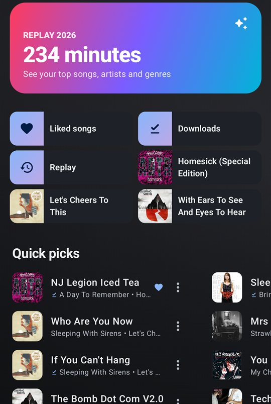
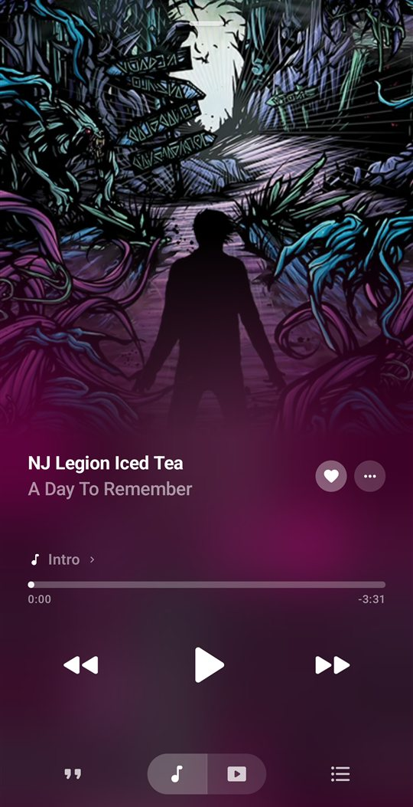
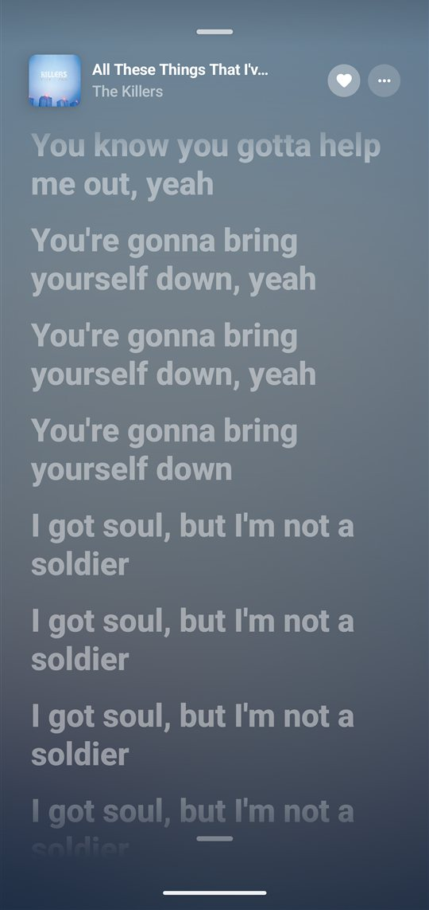
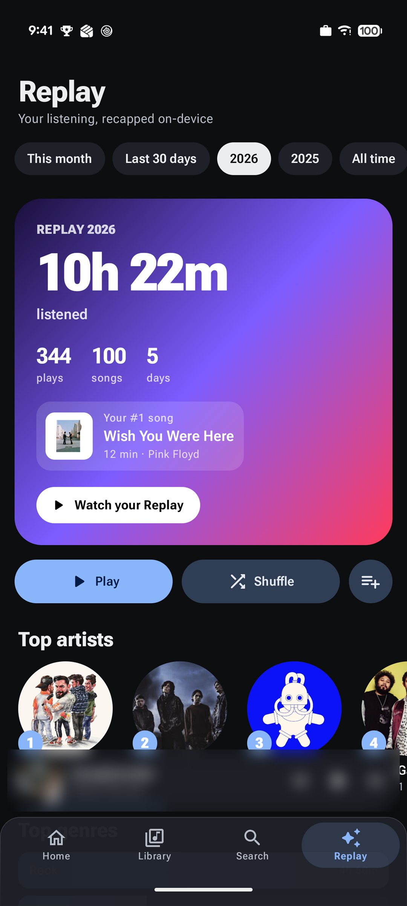

<div align="center">


# Prism

**Your music, refracted.**<br>
A free, open-source YouTube Music client for Android, with word-by-word lyrics, on-device recommendations,<br>karaoke, a DJ mode, Replay and full Android Auto support. No ads, no server, no tracking.

[](../../releases/latest)


[](LICENSE)
[](https://ko-fi.com/yigder)

### [⬇ Download Prism.apk](../../releases/latest/download/Prism.apk)

[What's new in 1.7.9.2](../../releases/tag/v1.7.9.2) · [Changelog](CHANGELOG.md) · [Watch the film](../../releases/download/v1.7.0/Prism-1.7-film.mp4)

<a href="../../releases/download/v1.7.0/Prism-1.7-film.mp4"></a>






</div>

> [!NOTE]
> Prism is an independent, unofficial app. It is not affiliated with, endorsed by, or connected to Google, YouTube or YouTube Music.

## New in 1.7.9: Prism in your language

The last of the 1.7.x updates: Prism in 31 languages, recommendations that keep finding new music, and your requests from GitHub and Reddit. New options start off, so nothing changes until you pick it.


- **31 languages (#105):** Spanish, Portuguese, French, German, Italian, Dutch, Swedish, Polish, Czech, Romanian, Hungarian, Greek, Russian, Ukrainian, Turkish, Arabic, Persian, Hebrew, Hindi, Bengali, Urdu, Indonesian, Malay, Vietnamese, Thai, Filipino, Japanese, Korean and Chinese, plus English. Prism follows your phone's language or the one you pick, right to left where the language is, with dates, counts and YouTube's own words to match. Translated with AI (Claude): corrections are welcome (see [Contributing](CONTRIBUTING.md)).
- **Recommendations that keep changing:** Daily Mixes that are half new every day, new music from YouTube Music's radio, "You might also like" and similar artists, no artist taking over, skipped suggestions resting for two months, and radio that sounds like radio.
- **Play a different version:** a song playing as the wrong recording can be swapped for the right one, and stays swapped.
- **You asked for it:** a slider on long playlists, genres off on playlists, the lyrics' source beside Sing, search in Local files (#225), fades between screens off (#227), sliders with their number (#209), Unlimited room for sung songs (#238), the widget's play button in another color, and more.
- **Fixes:** "Response code: 400" at the end of songs (#206), updating with the Home tab off (#201), Load ahead offline (#213), music videos jumping ahead (#203), colors from the cover (#233, #235, #236), widgets (#217), backups between copies (#204) and more. See the [changelog](CHANGELOG.md).

## 1.7.8: sound and listening, your way

The seventh of the 1.7.x customization updates, Prism 1.6's look back as a choice, and a long list of your requests from GitHub and Reddit.

- **Speed & pitch:** 0.5× to 2× and up to 12 semitones up or down, each on its own, with Slowed and Sped up a tap away, for now or every time Prism opens.
- **Crossfade your way:** four curves (Smooth, Straight, Gentle, DJ cut), a mark on the progress bar where the next song comes in, and covers that blend into each other with the music.
- **Volume and EQ:** Normalize volume at the level you like (-8 to -23 LUFS), albums kept as they are, your own equalizer presets shared as codes, and a preset of its own for the car, your earbuds or the speaker.
- **Fades and silence:** the sleep timer fades out, pause and play can fade, and podcasts get their own Skip silence.
- **Sing, simpler:** one microphone button by the lyrics; tap it for Sing, hold and slide for how much of the voice stays in.
- **Classic Prism (#155):** Prism 1.6's look as a Look of its own, or just its icons, its bold type, its plain controls or the player's buttons apart.
- **You asked for it:** Last.fm scrobbling (#133, #160), Replay for any dates (#149), choose what goes in a backup (#149), a queue made for editing (pick several, move or remove them, lock the order, #159), the player's controls over lyrics and the queue your way (#193, #197), swipe up for the queue (#200), the cover flying into the player (#199), Apple Lossless files (#135), lyrics into M4A files, a Prism Quick Settings tile, lock to portrait (#190), pause when muted (#157), Recently played as albums (#196), and more.
- **Fixes:** other apps' play, pause and skip work again (#178, #187), Premium quality on phones where it failed (#179), translations that stopped (#198), a song that wouldn't play after a quality change, closing Prism from its notification, local covers (#143), the ⋯ menu's over-scroll (#147) and more. See the [changelog](CHANGELOG.md).

## 1.7.7: shapes, icons, type and widgets your way

The sixth of the 1.7.x customization updates, plus your requests from GitHub and Reddit.

- **Covers' shapes:** songs, albums and playlists, artists and the player's cover, each in its own shape (rounded, square, circle, squircle, flower, cookie, arch or slanted), corners as a slider, and buttons as a pill, rounded or square.
- **Icons:** outline, duotone or filled, two new packs (**Facet** and **Dots**), and six more app icons (Dusk, Paper, Neon, Pastel, Line and Gold).
- **Text:** Light, Regular or Bold for all of Prism, letter spacing, titles in a font of their own, and two fonts for reading: Legible (Atkinson Hyperlegible) and Dyslexia-friendly (OpenDyslexic).
- **Widgets, each its own way:** background, color, text and what each widget shows, picked with a live preview; on Android 12+ they take your light's colors.
- **You asked for it:** the light from the cover (#123), rearrange your playlists' songs (#140), Newest first (#141), swipe songs out of the queue, swipe the mini player up, pull the queue down to close it (#149), move songs while shuffled, a History tile (#136), clear the Looks history (#152), a Ribbons progress bar (#151), title weight on the player, add a whole album or playlist to a playlist, and share as YouTube links.
- **Fixes for YouTube's October changes:** album songs play as songs again signed out, and Songs, not videos works again (#138). Plus every YouTube Music playlist in the Library, crossfade with the equalizer on, skipping from other apps' widgets, and more. See the [changelog](CHANGELOG.md).

## 1.7.6: Home, Library and Search your way, and a lighter, faster Prism

The fifth of the 1.7.x customization updates, and a performance one.

- **Performance mode:** one switch for slower phones that draws Prism about as lightly as 1.6 did (no blur, glass, moving backgrounds or animated covers), with nothing you picked changed. In testing on Android 9, Home scrolled with half the processor time and frames drew 4–5× faster. Phones on Android 9 or older, or with 4 GB of memory or less, are offered it once.
- **Faster and lighter for everyone:** about 200 MB less memory in the first minute after opening (the likely cause of Prism being closed on phones with little memory, #103), animated covers using far less memory, long playlists and searches that no longer hold up the screen, and Library and Settings opening faster after an update.
- **Search, redesigned (#124):** type a line from a song and find it **from the lyrics**. Before you type: what you opened lately, recent searches, your artists, and moods and genres. While typing, just suggestions with their pictures, then one row of chips, and your own matches (library, this phone) right after the top result.
- **Home your way:** pin any album, playlist, artist or mix as its own section, sections from your own listening, rename any section, and a new top of Home (a picture, or the playing cover, behind the greeting).
- **Library your way:** playlist folders, pinned items, a list or grid for each tab with 2–4 covers across, **make your own playlist covers** and use your own photo of an artist.
- **Tabs your way:** Downloads, Liked songs and Podcasts as tabs (up to six), rename them, words only, height and background, swipe between tabs, and a mini player joined to the tab bar.
- **Playlists without an account:** keep any YouTube playlist in your library signed out, save a copy as your own Prism playlist, save the queue, or open a playlist from a link.
- **Settings, easier to find:** sorted by what they do (Customize Prism, Playback & sound, Lyrics & Sing, Controls & gestures, …), shorter pages, every mobile-data switch in one place.
- **From GitHub:** Home opens straight away (#126), full-bleed music videos (#120), the player's lyric line centered and on two lines (#121), Featured and Community playlists in Search (#130), Quick picks and Speed dial in any language (#131), and fixes for podcast episodes turning LIVE (#128), local songs' covers (#129) and settings listed twice (#127). See the [changelog](CHANGELOG.md).

## 1.7.5: lyrics, your way

The fourth of the 1.7.x customization updates, plus five of your GitHub requests and a lighter Prism.

- **Six lyric styles:** Prism, Classic karaoke, **Bold card** (big bold lines on the cover's color), **Glow**, **Typewriter** and **Calm**. Pick their colors, weight, spacing, focus blur, capitals, where the sung line sits, how translations sit with each line, and what's behind the lyrics (blurred cover, animated cover, the cover's color or your own). Every choice shows what it looks like.
- **History** in Library: what you played, by day, on this phone or (signed in) on your YouTube Music account (#118).
- **A song and its video as one** in your liked songs (#111), **Prism's own volume** apart from the phone's (#116), and **hide the status bar** (#115).
- **Tidier settings:** every explanation sits behind an ⓘ beside what it explains (#119), and Library's tiles are edited from a button at the top.
- **Lighter on the battery:** nothing works differently, but Prism stops drawing what's hidden under the player, pauses its clocks while you're in another app, and does less while lyrics are paused. See the [changelog](CHANGELOG.md).

## 1.7.4: the player, your way

The third of the 1.7.x customization updates, and a faster Prism on older phones.

- **Six layouts:** Standard, Cover, Lyrics, Minimal, **Vinyl** (the cover as a record's label, turning as it plays) and **Cassette** (reels turning as it plays). Every choice shows what it looks like.
- **Make it yours:** pick three to six buttons under the controls (now with a **speed** button), choose the notification and car buttons, order everything under the title, a waveform progress bar, thinner or thicker with a dot, line or ring, the title's size and alignment, the background (any of Prism's or your own photo, just for the player), and what swipes, a double tap and a long press do.
- **A visualizer**, off unless you pick one: bars, a wave, a ring around the cover, a pulsing progress bar or a glow. It listens to Prism's own sound (no microphone) and costs nothing when it's off.
- **Drag to reorder** anywhere you put things in order: hold a row and drag it, all the way from the bottom to the top in one move.
- **Faster:** Prism carries a startup profile and updates from the update banner are compiled while they install, the player redraws far less while music plays, and Home and Search do less work as you scroll.
- **Fixes:** shuffle and repeat after a restart (#101), live versions played as the studio song (#113), the font picker (#117), the browser remote's queue (#112), Speed dial margins (#67), a crash on Android 8 with Bluetooth headphones, and "Last crash" now says when the phone itself closed Prism (#103). See the [changelog](CHANGELOG.md).

## 1.7.3: Looks

The second of the 1.7.x customization updates.

- **Looks.** Save your colors, type, icons, backgrounds, player and lyrics as a Look and switch with one tap. Six of Prism's own to start from, your own ones updated as you change them, a different Look by day and by night, and Undo for every change.
- **Share and browse.** Send a Look as a QR code, a code or a `.prismlook` file, or pick one made by the community ([`themes/`](themes/), added by pull request). Every Look shows as a preview before it changes anything.
- **Customize by tapping.** Tap the mini player, the tab bar, the player or a Home section to change just that, right where it is. Every look page has a live preview pinned at the top.
- **Fixes:** a crash on low-memory phones (#103), Liked songs order (#99), songs not available in your country (#93), your own uploads (#101), lyric timing up to two minutes (#109), the time-of-day mix's name, and Android Auto pictures. See the [changelog](CHANGELOG.md).

## 1.7.2: color

The first of the 1.7.x customization updates.

- **Color, your way.** A full color picker (wheel, codes, eyedropper), 12 light presets plus White / Black or your own colors, any accent, a tinted page background and a text contrast setting. Every choice shows what it looks like, and each one says everything it changes in the app.
- **Also new:** app icon shortcuts, song credits, Library tiles you pick (and playlists first), Prism playlists pinned to Home, New releases filters, square covers for videos, lyrics only when opened on mobile data, a list of which downloads failed and why, and an Android Auto with tabs and covers.
- **Fixes** for crossfade, DJ mode lag, volume hiccups, stutters on slower phones, slow start-up, Pure black and more. See the [changelog](CHANGELOG.md).

## What's new in 1.7

The biggest update yet: a complete redesign, and a set of features that run on your phone.

- **A new look.** Color from what's playing under frosted glass, with Prism's split light on what's playing, progress and the Play ring. New icons, new app icons, seven bundled fonts, and lyrics that thicken word by word as they're sung. Prefer it quieter? Try the **White** light.
- **Sing.** Takes the singer's voice out of the song that's playing, on your phone. Leave a little in, or none, and move the key.
- **DJ mode.** Orders your queue by key and tempo so every song blends into the next, beat-matched.
- **Made for you.** Daily Mixes, a time-of-day mix, Release Radar, Smart Shuffle, and an autoplay radio built from your own listening.
- **Blend, Song Recognition, Prism Connect** (Google Cast, DLNA, a browser remote and handoff), **Rewind** for every year, **best part**, **romanized lyrics**, **headphone correction** and **tablet layouts**.
- **Faster:** songs start in under a second on Wi-Fi, and whole songs are buffered.

Everything else is in the [release notes](../../releases/tag/v1.7.0) and the [changelog](CHANGELOG.md).

## Features

<table>
<tr>
<td width="25%"></td>
<td width="25%"></td>
<td width="50%">

### Lyrics, word by word
Ten lyric sources, karaoke timing first: Apple Music's timed lyrics (via Better Lyrics), QQ Music, NetEase, KuGou, LyricsPlus, LRCLIB and more. Background vocals, right-to-left scripts, translations, and **romanized lyrics** for Korean, Japanese, Chinese, Arabic, Hindi, Russian and Greek. **Immersive mode** turns the cover and lyrics into a full-screen lyric video. Six lyric styles (Prism, Classic karaoke, Bold card, Glow, Typewriter, Calm) with your own colors, weight, spacing and background.

</td>
</tr>
<tr>
<td></td>
<td></td>
<td>

### Sing and DJ mode
**Sing** separates the voice from the music on your phone (Deezer's Spleeter model, a one-time download), so you can sing over the real song. One button by the lyrics: tap for Sing, hold and slide to keep a little of the lead or none; shift the key up to six semitones.

**DJ mode** finds each song's key and tempo and orders the queue around the Camelot wheel, with long blends where keys sit together. Pick Steady, Build up or Wind down. Works in Android Auto too.

</td>
</tr>
<tr>
<td></td>
<td></td>
<td>

### Made for you, made on your phone
Daily Mixes, a mix for this time of day, **Release Radar** for your artists' new music, **Smart Shuffle**, On repeat, Forgotten favourites, and Quick picks built around the artists you play. When a queue ends, Prism's own radio carries on from your listening, mixed with YouTube's or not. None of your listening leaves the phone.

</td>
</tr>
<tr>
<td></td>
<td></td>
<td>

### Replay and Rewind
Minutes, top songs, artists and genres for today, this week, this month, the last 30 days, any year, any month or days you pick, or all time, worked out on the device. Each year gets a **Rewind** story (opening December 1), with shareable slides. Home leads with a Replay card in nine styles.

</td>
</tr>
<tr>
<td></td>
<td></td>
<td>

### Recognize, podcasts and more
**Song Recognition** from Search, a Quick Settings tile or a home-screen widget; only an audio fingerprint is sent. A **Prism** tile plays and pauses from Quick Settings. **Podcasts** with search, 15/30-second skips, speed and resume. **Blend** makes a shared playlist with a friend from one QR code.

</td>
</tr>
<tr>
<td></td>
<td></td>
<td>

### Yours, and private
A **Prism Account** is just a name and picture on your phone: no email, no password, no server. Make playlists and save albums without a YouTube account, play your own music files, and keep Home working offline. Or sign in to sync likes, playlists, albums and artists with YouTube Music.

</td>
</tr>
</table>

### Everything else

| | |
|---|---|
| **Play anywhere** | Prism Connect casts to Chromecast, Google TV and DLNA/UPnP speakers, TVs and receivers (no Google SDK), controls Prism from any browser on your Wi-Fi, and hands playback to another phone or tablet. |
| **Listen together** | Phones on the same Wi-Fi play in step, or friends add songs to your queue. No account, no server. |
| **Sound** | 10-band EQ with your own presets (shared as codes, one per output), headphone correction for about 9,000 models (AutoEq), loudness normalization at the level you pick (albums kept as they are), Prism Spatial, Crossfade with four curves and beat matching, speed and pitch, fades, and lossless playback of your FLAC and ALAC files. |
| **Offline** | Downloads with saved lyrics and covers, Smart Downloads (songs you'll likely play next, fetched ahead), and your own music files. |
| **Music videos** | Switch any song to its official video in one tap, lyrics still in sync, full screen in landscape. |
| **Best part** | Jump straight to the part listeners replay most, or set your own. |
| **Make it yours** | Looks you save, share and switch (by day and night too), community Looks, customize by tapping, a full color picker, fonts (or your own), cover and button shapes, glass, backgrounds, tab bar and mini player styles, icon packs (Prism, Classic, Cupertino, Facet, Dots), twelve app icons, and the Classic Look for Prism 1.6's style. |
| **Tablets and foldables** | A side rail, the player beside its lyrics or queue, and a tabletop layout for half-open foldables. |
| **Android Auto** | Your library, Made for you, Shuffle play and Play as a DJ set, extra buttons, and lyrics on the car screen. |
| **Share** | Story cards and links for songs, albums, playlists and artists, and "Play in Prism" for YouTube links. Discord status with album covers and Last.fm scrobbling (both optional). |
| **Voice** | "Hey Google, play … on Prism" with Google Assistant and Gemini. |


> [!WARNING]
> **Android Auto lyrics are for passengers and for use while parked only.** Do not read lyrics while driving. You can turn car lyrics off in Settings → Devices & connections → Android Auto, or with the lyrics button on the car's player.

## Install

1. Download **[`Prism.apk`](../../releases/latest/download/Prism.apk)** on your phone (Android 8.0 or newer).
2. Open it. Android will ask you to allow installs from your browser or file manager.
3. Optional: sign in with your YouTube Music account to sync your library.

Prism checks for updates itself: tap the banner on Home and it installs the new version over the old one, keeping your downloads, Replay history and settings.

## Privacy

Prism talks to YouTube Music and the lyric services directly from your phone. There is no Prism server and no telemetry. Listening history, Replay, recommendations, downloads and settings stay on the device; if you sign in, your session is stored only in the app's private storage. Listen Together, Blend and handoff only talk to other phones on your local network, and only while they're open. A few features send the minimum they need: song recognition sends an audio fingerprint to Shazam, and lyrics translation and some romanization send the lyrics' text to Google Translate.

## Credits and inspiration

Prism doesn't ship artwork, fonts or code copied from other apps, but several ideas and data sources come from elsewhere:

- **Apple Music** inspired the artist pages (including its 2026 frosted redesign), starred most-played album tracks, headline artist typefaces, animated covers and Sing's controls. **BitChord** (itself modelled on Apple Music) inspired the Now Playing screen.
- **Spotify** inspired Daily Mixes, Release Radar, Smart Shuffle, Blend, Crossfade and the DJ-style mixing; **Spotify Wrapped** inspired Replay and Rewind; **Spotify Jam** inspired Listen Together (built here without any server); Spotify and Apple Music's share cards inspired the story cards.
- **Spotify Connect** and Apple's Handoff inspired Prism Connect. Speakers and TVs are reached with the open UPnP / DLNA standards, and Google Cast devices with the Cast protocol as open-source projects such as [pychromecast](https://github.com/home-assistant-libs/pychromecast) and [node-castv2](https://github.com/thibauts/node-castv2) document it (no Google SDK in Prism).
- **Lyrics:** [Better Lyrics](https://betterlyrics.org) (Apple Music TTML and QQ Music "Portato"), NetEase, KuGou, LyricsPlus, Bini, [LRCLIB](https://lrclib.net), Unison, Genius and YouTube Music. Lyrics belong to their rights holders.
- **Animated covers** come from Apple Music, Tidal and the ViVi Music canvas list.
- **Playlist import** hands off to [TuneMyMusic](https://www.tunemymusic.com). It's a separate service; Prism shares nothing with it.
- **Signed-in streams:** [yt-dlp's EJS solver](https://github.com/yt-dlp/ejs) (Unlicense, bundling [meriyah](https://github.com/meriyah/meriyah) and [astring](https://github.com/davidbonnet/astring)) deciphers them, on WebView's JavaScript engine through androidx.javascriptengine.
- **Song recognition** uses Shazam's service, with the audio fingerprint ported from [SongRec](https://github.com/marin-m/SongRec) (GPL-3.0). Only the fingerprint is sent, never the sound.
- **Sing** separates voices with Deezer's [Spleeter](https://github.com/deezer/spleeter) model (MIT), as converted to ONNX by [sherpa-onnx](https://github.com/k2-fsa/sherpa-onnx), on [ONNX Runtime](https://github.com/microsoft/onnxruntime).
- **Headphone correction** profiles come from [AutoEq](https://github.com/jaakkopasanen/AutoEq) (MIT); **release dates** for Release Radar from Deezer's public API; **genres** from Apple's iTunes Search API, then Deezer's.
- **Fonts:** Outfit, Manrope, Plus Jakarta Sans, Urbanist, Nunito, Fraunces and Geist Mono, all under the SIL Open Font License.
- **Libraries:** [NewPipe Extractor](https://github.com/TeamNewPipe/NewPipeExtractor), [Haze](https://github.com/chrisbanes/haze), [Coil](https://coil-kt.github.io/coil/), Media3 ExoPlayer and the rest of the stack below. Every library and its license is listed in the app under Settings → Backup & about → Open-source licenses.
- **The film's music** is "Minimal Tech" by PaulYudin (Pixabay).
- Music and metadata are streamed from YouTube Music. All trademarks belong to their owners.

## Support Prism

Prism is free, has no ads and doesn't track you. It's built and maintained in my spare time. If you enjoy it and want to help keep it going, you can buy me a coffee on **[Ko-fi](https://ko-fi.com/yigder)**. Every tip helps, and is never expected.

<a href="https://ko-fi.com/yigder"></a>

## Building from source

Requirements: JDK 17+ and the Android SDK (compile SDK 37).

```bash
./gradlew :app:assembleRelease
```

The APK lands in `app/build/outputs/apk/release/`. Without a `keystore.properties` (and its keystore) in the project root, release builds are signed with the debug key so they install directly; official releases use Prism's own key, so a self-built APK installs beside them only after uninstalling the official one. Release builds are deliberately unminified (NewPipe Extractor and Rhino rely on reflection).

Unit tests (some call live lyric and YouTube Music endpoints, so they need a network connection):

```bash
./gradlew :app:testDebugUnitTest
```

| Area | Where (`app/src/main/java/com/prism/music/`) |
|---|---|
| YouTube Music API, parsing and search ranking | `data/innertube/` |
| Stream resolving | `data/stream/` |
| Lyric providers and TTML / LRC / QRC / YRC / KRC parsers | `data/lyrics/` |
| Made for you, Blend and song recognition | `data/foryou/`, `data/blend/`, `data/recognize/` |
| Playback service, audio effects, Sing, DJ mode, Android Auto | `playback/` |
| Prism Connect (casting, browser remote, handoff) | `connect/` |
| Downloads and Smart Downloads | `download/` |
| Compose UI and design kit | `ui/` |

Stack: Kotlin, Jetpack Compose (Material 3), Media3 ExoPlayer and MediaSession, Room, DataStore, OkHttp, kotlinx.serialization, Coil, WorkManager, NewPipe Extractor, ONNX Runtime (downloaded on first use of Sing).

## Contributing

Bug reports, ideas and pull requests are welcome in [Issues](../../issues). See [CONTRIBUTING.md](CONTRIBUTING.md) for how to build, test and send changes.

## License

Copyright (C) 2026 Yigder

Prism is free software: you can redistribute it and/or modify it under the terms of the [GNU General Public License](LICENSE) as published by the Free Software Foundation, either version 3 of the License, or (at your option) any later version. It is distributed in the hope that it will be useful, but without any warranty; see the license for details.

The license covers Prism's own code. The libraries it's built with keep their own licenses (listed in the app under Settings → Backup & about → Open-source licenses). Music, artwork, lyrics and the YouTube and YouTube Music names belong to their respective owners, and Prism is not affiliated with Google or YouTube.
