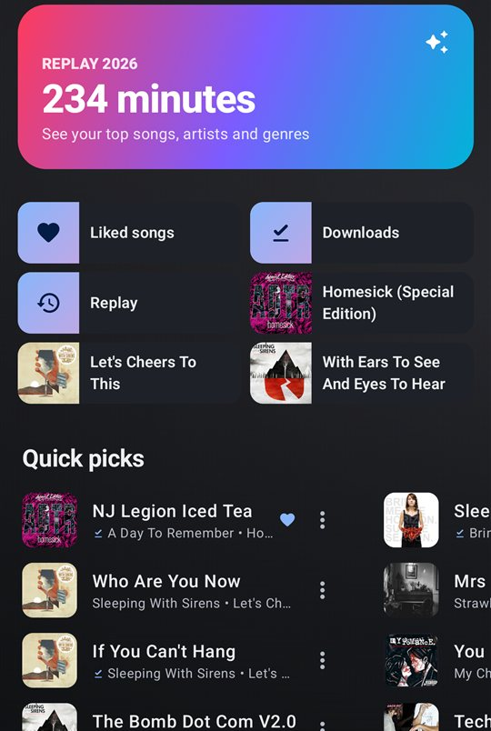
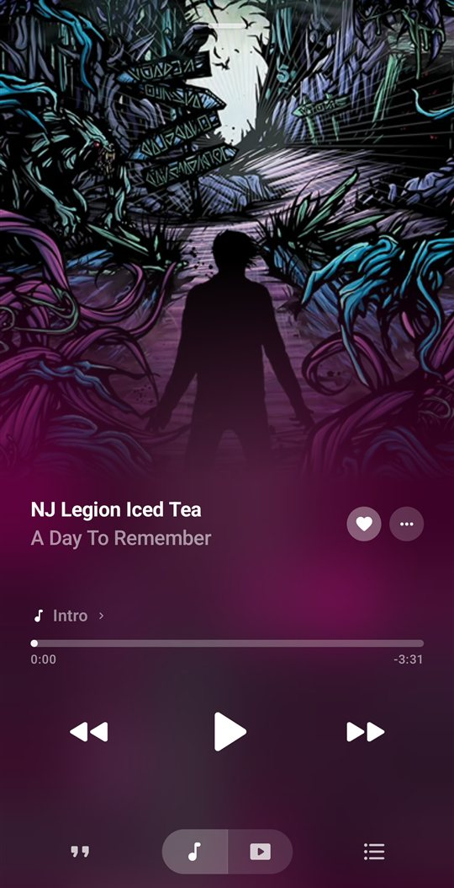
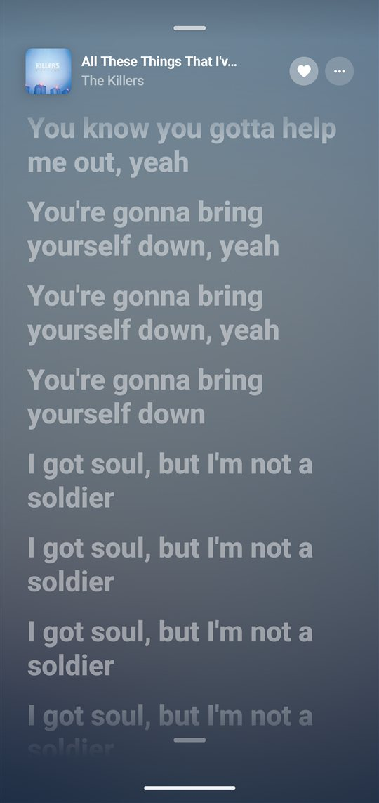
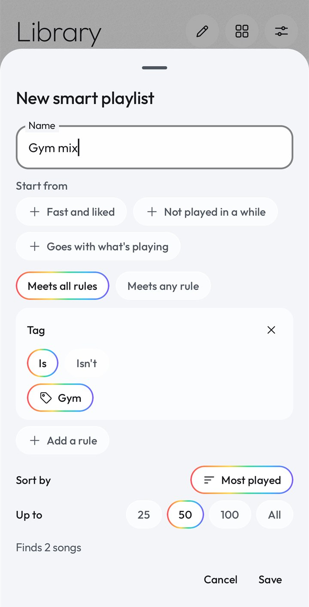
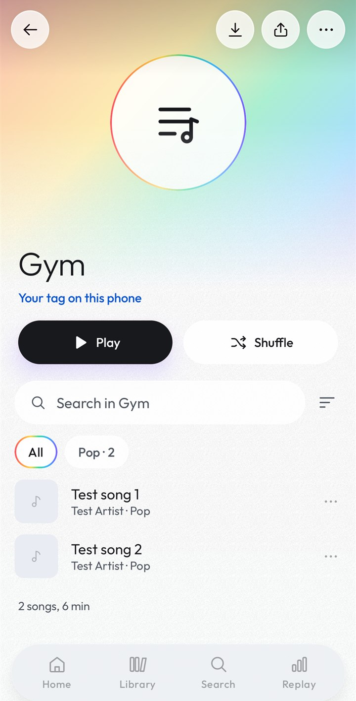
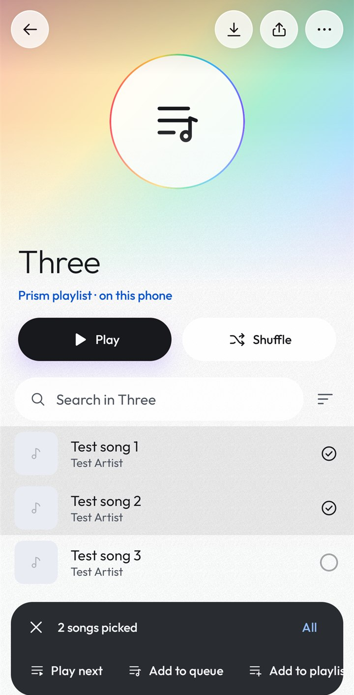
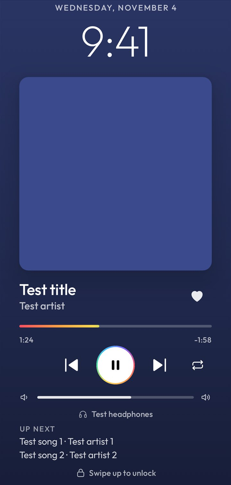
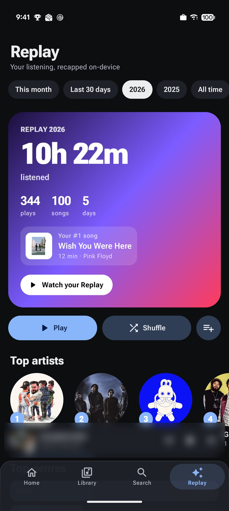
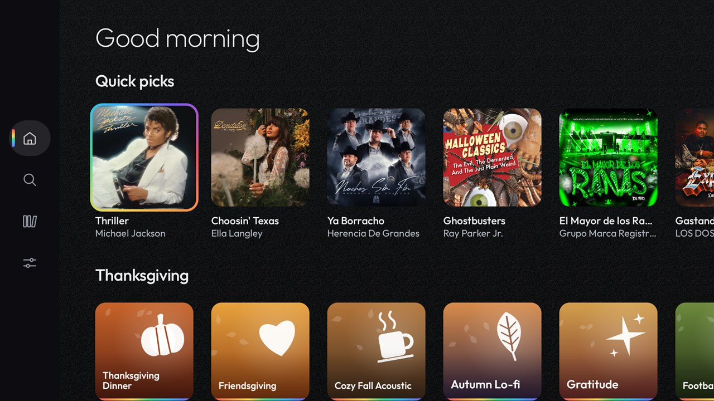
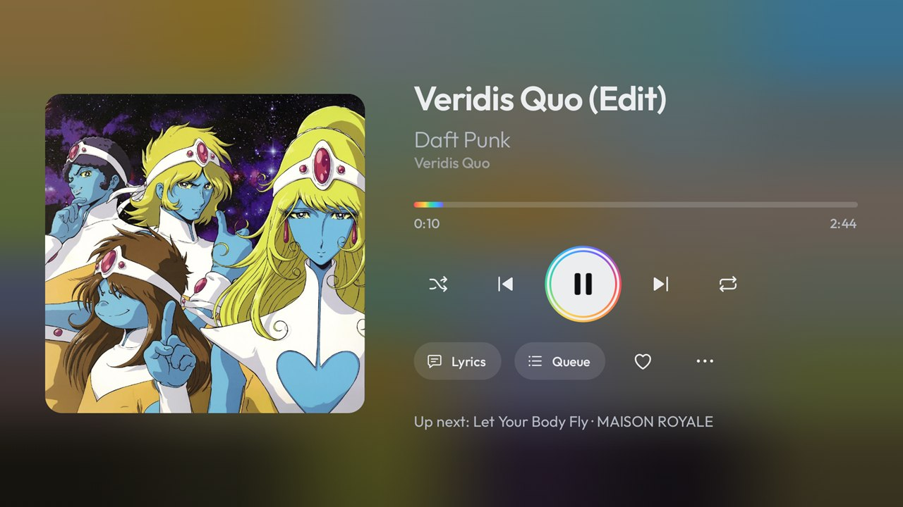

# Prism

**Your music, refracted.** 
A free YouTube Music app for Android phones and TVs. 
Lyrics that light up word by word, mixes made on your phone, and no ads or tracking.

### [⬇ Download Prism.apk](../../releases/latest/download/Prism.apk)

[What's new](../../releases/latest) · [All changes](CHANGELOG.md) · [Watch the film](../../releases/download/v1.7.0/Prism-1.7-film.mp4)

> [!NOTE]
> Prism is an independent, unofficial app. It is not affiliated with, endorsed by, or connected to Google, YouTube or YouTube Music.

## Install

1. Download **[Prism.apk](../../releases/latest/download/Prism.apk)** on your phone (Android 8.0 or newer).
2. Open it. Android will ask you to allow installs from your browser or file manager.
3. That's it. You can sign in with your YouTube Music account to sync your library, or skip that.

Updates: when there's a new version, tap the banner on Home. Your downloads, history and settings are kept.

**On a TV** (Android TV or Google TV): type code **8986606** into the Downloader app on the TV. Or, on your phone, turn on Settings → Speakers, TVs & browser → Share Prism with a TV, then type the address it shows into the TV.

### If Android says "App was denied access"

The optional lock screen player needs a permission called "Display over other apps". From Android 13, Android may refuse it at first, because Prism doesn't come from a store. To allow it:

1. Open Prism's App info page, and tap ⋮ at the top right.
2. Tap **Allow restricted settings**.
3. Go back and allow the permission.

Prism walks you through this on the setting's page. It uses the permission only to bring its player up on your lock screen, and never draws over other apps.

## New in 1.8.3

Your library, smarter.

- **Smart playlists** fill themselves from rules you set: tempo, key and energy, what you like, play, download or tag.
- **Tags:** your own labels on songs, each with its own page in Library.
- **Select many:** hold a song in a list to pick more, then add, tag, like or download them all at once.
- **Search your library** as you type, with filters. Japanese, Korean, Russian and Greek titles can be found in Latin letters.
- **Also new:** find duplicates in a playlist, a file on your phone as a song's version, Repeat and Up next on the lock screen, upload and delete in Uploads.
- **Fixes** for mixes that stuttered, songs starting over after Prism was closed, casting in the background, and more.

See every change in the [changelog](CHANGELOG.md).

## What Prism does

<table>
<tr>
<td width="25%"></td>
<td width="25%"></td>
<td width="50%">

### Lyrics, word by word
Lyrics from ten sources, with translations and pronunciation for languages like Korean, Japanese and Arabic. Pick from six styles, or turn the cover and lyrics into a full-screen lyric video.

</td>
</tr>
<tr>
<td></td>
<td></td>
<td>

### Sing and DJ mode
**Sing** takes the singer's voice out of the song, so you can sing along to the real track. **DJ mode** puts your queue in an order where each song blends into the next.

</td>
</tr>
<tr>
<td></td>
<td></td>
<td>

### Mixes made on your phone
Daily Mixes, new music from your artists, and a radio that keeps playing when your queue ends. Your listening history never leaves your phone.

</td>
</tr>
<tr>
<td></td>
<td></td>
<td>

### Replay and Rewind
See your top songs, artists and genres for any time you pick. Every December, you get a **Rewind** story of your year to share.

</td>
</tr>
<tr>
<td></td>
<td></td>
<td>

### Find songs, and podcasts too
Find out what song is playing around you. Listen to podcasts with speed control, skip buttons, and a memory of where you stopped.

</td>
</tr>
<tr>
<td></td>
<td></td>
<td>

### No account needed
Make playlists and save albums without signing in. Or sign in to sync your likes, playlists, albums and artists with YouTube Music.

</td>
</tr>
</table>

### Prism on your TV

Big lyrics, music videos and Sing, with screens made for a remote. Your phone can act as the remote too, and sign the TV in for you.

### And more

| | |
|---|---|
| **Make it yours** | Colors, fonts, icons, backgrounds, and layouts for the player and lyrics. Save them as a Look, share it, or try one from the community. |
| **Lock screen player** | Turn it on to see the cover, controls and lyrics on your lock screen. |
| **Offline** | Download songs with their lyrics and covers. Prism can also download songs you'll likely play next, and it plays your own music files. Artist pages work offline too. |
| **Sound** | Equalizer, headphone correction, even volume between songs, crossfades, speed and pitch, and lossless playback of your own files. |
| **Play anywhere** | Send music to Chromecast, Google TV and other speakers and TVs on your Wi-Fi. Control Prism from a browser, or move playback to another phone. |
| **Listen together** | Phones on the same Wi-Fi play in step, and friends can add songs to your queue. Make a shared Blend playlist with a friend from a QR code. |
| **Music videos** | Switch any song to its official video in one tap, with the lyrics still in sync. |
| **Bring your history** | Bring in your plays and playlists from Spotify's data download, YouTube Music or Last.fm. They stay on your phone. |
| **Connect other services** | Optional Last.fm scrobbling and Discord status. Spotify connects through a free developer app you make yourself, not a regular Spotify sign-in, and Prism walks you through it. |
| **Android Auto** | Your library, your mixes, and lyrics on the car screen. |
| **Your language** | Prism comes in 31 languages. They were translated by AI (Claude), so [corrections are welcome](CONTRIBUTING.md#translations). |
| **Slower phones** | Performance mode is one switch that makes Prism much lighter to run. |

> [!WARNING]
> **Android Auto lyrics are for passengers and for use while parked only.** Do not read lyrics while driving. You can turn car lyrics off in Settings → Devices & connections → Android Auto, or with the lyrics button on the car's player.

**Prism not in Android Auto's list?** Android Auto hides apps that don't come from the Play Store. Open Android Auto's settings, tap the version number about 10 times, then in the ⋮ menu → Developer settings turn on **Unknown sources**.

## Privacy

There is no Prism server and no tracking. Your history, recommendations, downloads and settings stay on your phone. If you sign in, your session is stored only inside the app.

Prism connects directly from your phone to YouTube Music, to lyric services, and to a few music services for genres and release dates. A few features also send what they need to work:

- **Song recognition** sends an audio fingerprint to Shazam, never the sound itself.
- **Lyrics translation** and some pronunciation guides send the lyrics' text to Google Translate.
- **Extras you turn on,** such as Last.fm, Spotify, Discord, Wikipedia bios and RSS podcasts, talk to those services.

Listen Together, Blend and moving playback to another phone only talk to other devices on your Wi-Fi, and only while they're open.

## Support Prism

Prism is free, and I build it in my spare time. If you enjoy it, you can buy me a coffee on **[Ko-fi](https://ko-fi.com/yigder)**. Every tip helps, and none is expected.

## Help out

Bug reports and ideas are welcome in [Issues](../../issues). To build Prism or send a change, see [CONTRIBUTING.md](CONTRIBUTING.md).

## Credits

Prism doesn't copy artwork, fonts or code from other apps, but many of its ideas and sources come from elsewhere.

**Ideas**

- **Apple Music:** artist pages, starred album tracks, artist name styles, animated covers and Sing's controls. **BitChord**, itself modeled on Apple Music, inspired the player.
- **Spotify:** Daily Mixes, Release Radar, Smart Shuffle, Blend, Crossfade, DJ-style mixing, share cards, and Listen Together (from Spotify Jam). **Spotify Wrapped** inspired Replay and Rewind.
- **Spotify Connect** and **Apple's Handoff:** playing on and moving music between devices. Open-source projects such as [pychromecast](https://github.com/home-assistant-libs/pychromecast) and [node-castv2](https://github.com/thibauts/node-castv2) document how Google Cast works.

**Sources and code**

- **Music and song info:** YouTube Music. Genres from Apple's iTunes Search API and Deezer. Release dates from Deezer.
- **Lyrics:** [Better Lyrics](https://betterlyrics.org), NetEase, KuGou, LyricsPlus, Bini, [LRCLIB](https://lrclib.net), Unison, Genius and YouTube Music. Lyrics belong to their rights holders.
- **Animated covers:** Apple Music, Tidal and the ViVi Music canvas list.
- **Playlist import:** handed off to [TuneMyMusic](https://www.tunemymusic.com), a separate service. Prism shares nothing with it.
- **Signed-in playback:** [yt-dlp's EJS solver](https://github.com/yt-dlp/ejs) (Unlicense), with [meriyah](https://github.com/meriyah/meriyah) and [astring](https://github.com/davidbonnet/astring).
- **Song recognition:** Shazam's service, with the fingerprint code ported from [SongRec](https://github.com/marin-m/SongRec) (GPL-3.0).
- **Sing:** Deezer's [Spleeter](https://github.com/deezer/spleeter) model (MIT), converted by [sherpa-onnx](https://github.com/k2-fsa/sherpa-onnx), on [ONNX Runtime](https://github.com/microsoft/onnxruntime).
- **Headphone correction:** [AutoEq](https://github.com/jaakkopasanen/AutoEq) (MIT).
- **Fonts:** Outfit, Manrope, Plus Jakarta Sans, Urbanist, Nunito, Fraunces, Geist Mono, Atkinson Hyperlegible Next and OpenDyslexic, all under the SIL Open Font License.
- **Libraries:** [NewPipe Extractor](https://github.com/TeamNewPipe/NewPipeExtractor), [Haze](https://github.com/chrisbanes/haze), [Coil](https://coil-kt.github.io/coil/), Media3 ExoPlayer and more. The app lists them all with their licenses in Settings → Backup & about → Open-source licenses.
- **The film's music:** "Minimal Tech" by PaulYudin (Pixabay).

All trademarks belong to their owners.

## License

Copyright (C) 2026 Yigder

Prism is free software: you can redistribute it and/or modify it under the terms of the [GNU General Public License](LICENSE) as published by the Free Software Foundation, either version 3 of the License, or (at your option) any later version. It is distributed in the hope that it will be useful, but without any warranty; see the license for details.

The license covers Prism's own code. The libraries it's built with keep their own licenses. Music, artwork, lyrics and the YouTube and YouTube Music names belong to their respective owners, and Prism is not affiliated with Google or YouTube.
